<picture>
  <source media="(prefers-color-scheme: dark)" srcset="assets/banner-dark.svg">
  
</picture>

I'm a sound engineer and the founder of [Prinvo](https://prinvo.net), a software company in Chile. I spent years mixing, mastering and designing audio plugins and pedals. Today I build and run business software end to end, and I'm moving into applied machine learning for audio.

- **Building now:** Prinvo ERP, with electronic invoicing for Chile's tax authority (SII), inventory and receivables for small businesses, in production. Logi, QR-based inventory for schools on Windows, macOS, iOS and Android.
- **Audio:** mixing and mastering for vinyl and streaming, Dolby Atmos certified, live sound and streaming for events in Berlin (Etikett Radio, XJAZZ Festival).
- **Learning:** applied ML for audio, from PyTorch fundamentals to small language models and spectrogram-based classifiers.
- **Stack:** TypeScript, Next.js, Node.js, PostgreSQL, SQLite, Python · Ableton Live

Most of my work lives in private repositories for clients. I'm happy to walk you through it.

<picture>
  <source media="(prefers-color-scheme: dark)" srcset="https://raw.githubusercontent.com/Faethreck/Faethreck/output/snake-dark.svg">
  
</picture>

  
  
  

